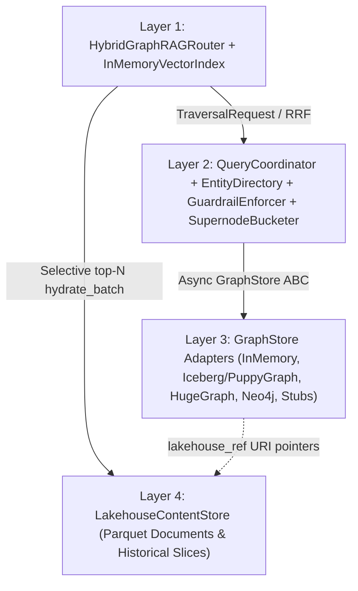

# Agent Nexus KG (`scale-kg`)

> Engine-agnostic semantic knowledge graph SDK and Gate 2 benchmark harness (100M–10B+ edge target trajectory) with pluggable `GraphStore` adapters for multi-hop Kinetic-V GraphRAG.

[](https://opensource.org/licenses/Apache-2.0)
[](https://www.python.org/)


**Agent Nexus KG (`scale-kg`)** implements the Phase 0 SDK foundations and Phase 1 benchmark harness for scaling Kinetic-V structural memory without vendor lock-in. It separates lightweight topological graph navigation from heavy document payloads, enforces query/write guardrails, partitions high-degree supernodes, and abstracts storage backends behind an async `GraphStore` interface.

---

## Capability Status

Following repository guidelines, capabilities are separated by verified implementation status:

### Implemented & Verified Locally (`pytest` / `ruff` / `mypy`)
* **Lean Semantic Graph & Guardrails (`scale_kg.core`):** Rejects heavy payload keys (`content`, `raw_text`, `embedding`, `history_blob`), enforces `lakehouse_ref` pointers on content-bearing entity types, rejects unmaterialized derived edges at write time, and bounds every traversal (`max_depth <= 3`, `max_results <= 5000`, `max_execution_seconds <= 2.0`, `max_expanded_nodes <= 50000`).
* **Deterministic 16-Way Supernode Bucketing (`SupernodeBucketer`):** Splits seeded (`technology:lang:python`, `customer:region:india`, `Language`, `Country`) and runtime-promoted hubs into `<hub_id>::bucket::0..15` via CRC32 hashing, executing 0-1 BFS (`BUCKET_LINK` at zero hop cost) and unwrapping bucket hops before returning logical paths.
* **Semantic Domain Federation (`QueryCoordinator` & `EntityDirectory`):** Partitions entities across `customer`, `knowledge`, `technology`, and `product` shards with O(1) Hop-0 `<domain>:<entity_type>:<slug>` parsing, alias canonicalization, in-shard ghost/proxy nodes, on-the-fly derived edge rules (`SIMILAR_TO`, `INDIRECTLY_USES`), and automatic hot-path promotion (`hot_path_threshold=3`).
* **Hybrid Vector + KG + Lakehouse Retrieval (`HybridGraphRAGRouter` & `LakehouseContentStore`):** 5-stage Seed-Then-Expand pipeline combining `InMemoryVectorIndex` cosine search, guarded KG expansion, Reciprocal Rank Fusion (`rrf_k=60`), selective top-$N$ PyArrow/Parquet hydration, and grounded `SourceCitation` assembly.
* **Reference & Zero-ETL Parquet Adapters:** `InMemoryGraphStore` (partitioned reference baseline with `FaultState` injection) and `IcebergPuppyGraphStore` local PyArrow mode (`domain=<d>/bucket_16=<b>` Parquet partitions, Iceberg v2 metadata, `puppygraph_schema.json`, partition-pruned scans).
* **Gate 2 Benchmark Harness (`scale_kg.benchmark`):** `PowerLawGraphGenerator` (`micro`, `local`, `cluster` presets), frozen `GoldenQuerySuite` (`GQ-01`..`GQ-07` cross-adapter parity), 7 PoC workloads (`BenchmarkSuite`), and automated weighted ADR generation (`generate_gate2_adr`).
* **FastAPI REST & gRPC Service (`scale_kg.api`):** FastAPI `/v1/*` REST API (`create_app()`), typed `ScaleKGGrpcServicer` & `scale_kg.proto` contract (`scale_kg.v1.ScaleKGService`), HTTP JSON-gRPC bridge, structured `GuardrailViolation` `422` errors, optional API-key auth, and `python -m scale_kg.api.app` CLI.
* **Interactive Showcase Dashboard (`scale_kg.showcase`):** Zero-build 5-tab dashboard served at `/showcase` (with `/showcase/api/snapshot` and live simulation endpoints) plus static bundle export (`python -m scale_kg.showcase.build`) with snapshot/history generation and PR delta summaries.

### Implemented & Verified Against Mock Transports / Drivers (Live Cluster Integration Pending)
* **`HugeGraphStore`:** Async `httpx` REST/Gremlin/OpenCypher client with PD partition headers and deterministic placement hints.
* **`Neo4jGraphStore`:** Async `AsyncCypherDriver` Composite shard adapter (`kg_<domain>`) with cross-shard proxy creation and continuation queues (optional `scale-kg[neo4j]` extra).
* **`IcebergPuppyGraphStore` (Remote Mode):** HTTP `/cypher` and `/gremlin` execution against a live PuppyGraph endpoint.

### Contract Stubs & Planned Infrastructure
* **Tier-2 Contract Stubs (`scale_kg.adapters.stubs`):** `JanusGraphStore` (ScyllaDB + OpenSearch Gremlin builder) and `NebulaGraphStore` (nGQL builder) extend `_ContractStubBase(InMemoryGraphStore)` for contract parity and Gate 2 modeling.
* **Planned (Not Yet Implemented in `src/scale_kg/`):** Kafka streaming ingestion pipelines, Kubernetes multi-AZ StatefulSets/Helm charts, OpenTelemetry/Prometheus/Langfuse exporters, OIDC/Entra ID auth, and live 100M–10B cluster benchmarks (see [System Design Specification](docs/DESIGN.md)).

---

## Architecture Overview



* **Architecture Document:** [docs/architecture.md](docs/architecture.md)
* **Low-Level Design & Diagrams:** [docs/low-level-design.md](docs/low-level-design.md)
* **Original System Design & Roadmap:** [docs/DESIGN.md](docs/DESIGN.md)

---

## Repository Structure

```text
scale-kg/
├── Makefile                    # setup, demo, dev, showcase, showcase-build, and check targets
├── netlify.toml                # Netlify publish dir, CSP/security headers, and cache rules
├── CHANGELOG.md                # Release and unreleased change notes
├── portfolio.yaml              # Portfolio product manifest
├── pyproject.toml              # Package metadata, dependencies, ruff & mypy config
├── .github/workflows/          # CI checks and automated Netlify showcase deployment
├── docs/
│   ├── architecture.md         # 4-layer architecture, adapters, SLAs, status matrix
│   ├── low-level-design.md     # Class, sequence, state, ER, and flow diagrams
│   ├── DESIGN.md               # Initial system design spec & 24-week roadmap
│   ├── proposal/               # Project proposal documents
│   └── superpowers/            # Design specs and implementation plans
├── src/scale_kg/
│   ├── config.py               # GuardrailConfig, LatencyBudgetConfig, ScaleKGConfig
│   ├── demo.py                 # Deterministic offline in-memory traversal demo
│   ├── api/                    # FastAPI REST endpoints, gRPC servicer, proto contract
│   ├── core/                   # Domain models, GuardrailEnforcer, SupernodeBucketer
│   ├── routing/                # EntityDirectory, QueryCoordinator, HybridGraphRAGRouter
│   ├── adapters/               # GraphStore ABC, 0-1 BFS, InMemory, Iceberg, HugeGraph, Neo4j, stubs
│   ├── lakehouse/              # Parquet-backed LakehouseContentStore
│   ├── benchmark/              # PowerLawGraphGenerator, GoldenQuerySuite, 7 workloads, Gate 2 ADR
│   └── showcase/               # Interactive dashboard router, snapshot builder, static UI assets
└── tests/                      # Unit, adapter contract, E2–E4 validation, and benchmark suites
```

---

## Quickstart

Requires **Python 3.11+** and [`uv`](https://docs.astral.sh/uv/).

```bash
# 1. Install locked dependencies
make setup

# 2. Run the deterministic offline demo (no external DB or API keys required)
make demo

# 3. Run formatter, linter, typechecker, pytest suite, and wheel/sdist build
make check

# 4. Build static showcase bundle and launch local interactive dashboard at /showcase
make showcase
```

---

## Interactive Showcase Dashboard & Netlify Deployment

* **Local Live Server (`make showcase`):** Runs `make showcase-build` (`python -m scale_kg.showcase.build --presets micro,local --out dist/showcase`) and starts `scale_kg.api.app` on `127.0.0.1:8000` with `SCALE_KG_SHOWCASE_SNAPSHOT=dist/showcase/snapshot.json`. Visit `http://127.0.0.1:8000/showcase` for the interactive dashboard and `/showcase/api/snapshot` for the JSON snapshot payload.
* **Static Bundle (`make showcase-build`):** Generates `dist/showcase/{index.html,snapshot.json,history.json,assets/*}` ready for static hosting via [netlify.toml](netlify.toml) (strict CSP/security headers and `Cache-Control` rules for `/snapshot.json`, `/history.json`, and `/assets/*`).
* **Automated CI/CD (`.github/workflows/showcase.yml`):**
  * Custom domain: `https://scale-kg.labbys-aoai.in` (configured via a Hostinger DNS `CNAME` record pointing to the Netlify site).
  * Pull requests deploy a Netlify preview (`pr-<number>`) and post a benchmark delta summary to `$GITHUB_STEP_SUMMARY`; pushes to `main` (and `workflow_dispatch`) deploy to production.
  * Repository secrets required in GitHub Actions: `NETLIFY_AUTH_TOKEN` and `NETLIFY_SITE_ID` (deploys are skipped cleanly when unset).

### Minimal Python SDK Example

```python
import asyncio
from scale_kg.adapters import InMemoryGraphStore
from scale_kg.core import Domain, EntityNode, RelationshipEdge, TraversalRequest
from scale_kg.routing import QueryCoordinator


async def main() -> None:
    coordinator = QueryCoordinator(InMemoryGraphStore())
    await coordinator.upsert_nodes(
        [
            EntityNode(
                id="customer:org:acme",
                domain=Domain.CUSTOMER,
                entity_type="Organization",
            ),
            EntityNode(
                id="technology:lang:python",
                domain=Domain.TECHNOLOGY,
                entity_type="Language",
            ),
            EntityNode(
                id="product:sdk:scale-kg", domain=Domain.PRODUCT, entity_type="Product"
            ),
        ]
    )
    await coordinator.upsert_edges(
        [
            RelationshipEdge(
                source_id="customer:org:acme",
                target_id="technology:lang:python",
                edge_type="USES",
                domain=Domain.CUSTOMER,
                target_domain=Domain.TECHNOLOGY,
            ),
            RelationshipEdge(
                source_id="technology:lang:python",
                target_id="product:sdk:scale-kg",
                edge_type="POWERS",
                domain=Domain.TECHNOLOGY,
                target_domain=Domain.PRODUCT,
            ),
        ]
    )
    result = await coordinator.traverse(
        TraversalRequest(seed_ids=["customer:org:acme"], max_depth=2)
    )
    print(result.paths)


asyncio.run(main())
```

---

## Gate 2 Latency Budgets (`LatencyBudgetConfig`)

| Metric | Target Budget | Enforced Guardrail (`GuardrailConfig`) |
| :--- | :--- | :--- |
| **1-Hop P95 Latency** | <= 25 ms | `max_depth <= 3` |
| **2-Hop P95 Latency** | <= 100 ms | `max_results <= 5,000` |
| **3-Hop P95 Latency** | <= 300 ms | `max_expanded_nodes <= 50,000` |
| **Hard Timeout** | <= 2,000 ms | `max_execution_seconds <= 2.0` |

---

## License

Licensed under the [Apache License 2.0](LICENSE).
