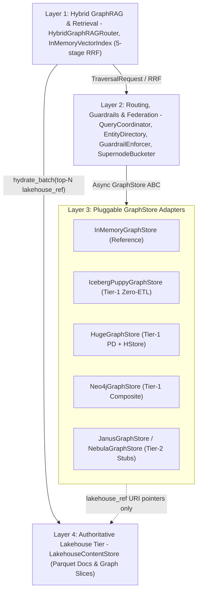
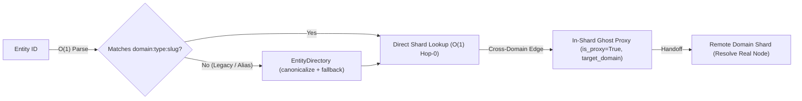

# System Architecture: Agent Nexus KG (`scale-kg`)

**Product ID:** `scale-kg` (`stage: lab`, Apache-2.0)  
**Target Scale Trajectory:** 100M -> 1B -> 10B+ Relationships  
**Primary Use Case:** Multi-hop structural memory & Hybrid Vector + Knowledge Graph RAG for Kinetic-V agents

---

## 1. Architectural Purpose & Scope

`scale-kg` provides an engine-agnostic, four-layer semantic knowledge graph SDK and benchmark harness. It isolates GraphRAG and agent reasoning code behind a strict `GraphStore` contract while enforcing structural discipline (lean vertices/edges, query-time edge derivation, and deterministic 16-way supernode bucketing) so 1-to-3 hop traversals stay bounded as graph scale grows from 100M to 10B+ edges.

For module-level class contracts, sequence flows, Parquet schemas, and algorithms, see [Low-Level Design](low-level-design.md). For the original project design specification and 24-week delivery roadmap, see [DESIGN.md](DESIGN.md).

---

## 2. Four Enforced Architectural Tenets

1. **Lean Semantic Graph Rule (`GuardrailEnforcer`):**
   - Only topological routing metadata (`id`, `domain`, `entity_type`, `routing_props`, `lakehouse_ref`, `is_proxy`, `target_domain`, `is_bucket`) resides in the graph tier.
   - Forbidden payload keys (`content`, `raw_text`, `embedding`, `history_blob`) are rejected at write time (`LEAN_GRAPH_FORBIDDEN_PAYLOAD`).
   - Content-bearing entity types (`document`, `chunk`, `passage`, `article`, `transcript`, `file`, `blob`, `artifact`) or nodes with `routing_props["has_content"] = True` must carry a non-empty `lakehouse_ref` (`LEAN_GRAPH_MISSING_LAKEHOUSE_REF`).
2. **Core Edges Only & Query-Time Derivation (`QueryCoordinator`):**
   - Derived edge types (`SIMILAR_TO`, `INDIRECTLY_USES`, or any edge with `is_derived=True`) are rejected at write time unless `materialized_hot_path=True` (`UNMATERIALIZED_DERIVED_EDGE`).
   - Inference executes on-the-fly during traversal via declarative `DerivedEdgeRule` definitions and automatically promotes frequently hit edges to `materialized_hot_path=True` once `hot_path_threshold` (default `3`) is reached.
3. **Deterministic 16-Way Supernode Bucketing (`SupernodeBucketer`):**
   - Seeded hubs (`Language`, `Country`, `technology:lang:python`, `customer:region:india`) and vertices whose degree reaches `supernode_degree_threshold` (default `1000` in `ScaleKGConfig`, configurable per bucketer) are split into 16 intermediate bucket vertices (`<hub_id>::bucket::0..15`) via `zlib.crc32(node_id) % 16`.
   - Bucket hops (`BUCKET_LINK`) carry zero logical depth cost in 0-1 BFS (`run_guarded_bfs`) and are unwrapped before returning `TraversalResult.nodes` and `TraversalResult.paths`.
4. **Hard Pre-Flight & Runtime Query Guardrails (`GuardrailConfig`):**
   - Every traversal is capped at `max_depth <= 3`, `max_results <= 5000`, `max_execution_seconds <= 2.0`, and `max_expanded_nodes <= 50000`.
   - Breaching a limit pre-flight raises `GuardrailViolationError`; breaching a limit mid-traversal returns a partial `TraversalResult` with `metrics.aborted = True` and structured `GuardrailViolation` metadata.

---

## 3. Four-Layer Logical Architecture

### Layer Responsibilities

| Layer | Implemented Modules | Core Responsibilities |
| :--- | :--- | :--- |
| **Layer 1: Hybrid Retrieval** | `scale_kg.routing.hybrid_rag` | Vector top-$K$ seed discovery, bounded KG expansion, Reciprocal Rank Fusion (`rrf_k=60`), selective top-$N$ payload hydration, grounded `SourceCitation` assembly. |
| **Layer 2: Routing & Guardrails** | `scale_kg.core`, `scale_kg.routing.directory`, `scale_kg.routing.coordinator` | Lean-graph write validation, pre-flight/runtime traversal budgets, O(1) Hop-0 `<domain>:<entity_type>:<slug>` routing, ghost/proxy federation, 16-way supernode bucketing, hot-path promotion. |
| **Layer 3: Storage Adapters** | `scale_kg.adapters.*` | Engine-neutral async `GraphStore` ABC, shared 0-1 BFS & bucket unwrapping (`_traversal.py`), fault injection (`FaultState`), and 6 engine adapters across reference, Tier-1, and Tier-2 stub tiers. |
| **Layer 4: Lakehouse Store** | `scale_kg.lakehouse.store` | PyArrow/Parquet authoritative storage for full document payloads (`documents/domain=<d>/documents.parquet`) and point-in-time `HistoricalGraphSlice` snapshots. |

---

## 4. Semantic Domain Sharding & Cross-Shard Federation

The graph is partitioned across four canonical `Domain` shards (`customer`, `knowledge`, `technology`, `product`):

- **Hop-0 O(1) Routing:** `parse_canonical_id()` extracts the owning `Domain` directly from `<domain>:<entity_type>:<slug>` (stripping any `::bucket::<k>` suffix) without querying a central index.
- **Directory Fallback & Aliasing:** `EntityDirectory` resolves legacy/opaque IDs via `_id_to_domain` and resolves alternate IDs via cycle-safe `canonicalize()`.
- **Ghost/Proxy Federation:** When `QueryCoordinator.upsert_edges()` writes a cross-domain edge in a split-shard topology, it automatically injects an in-shard ghost vertex (`is_proxy=True`, `target_domain=<dst_domain>`) into the source shard so local BFS immediately knows which remote shard owns the next hop.
- **Locality Telemetry:** Every `TraversalResult.metrics` reports `cross_domain_hops` and `single_domain_locality_ratio` so cross-partition overhead can be tracked directly.

---

## 5. Storage Adapter Landscape & Cost Profiles

All adapters implement `scale_kg.adapters.base.GraphStore` and expose an `AdapterCostProfile` for Gate 2 evaluation:

| Adapter Class | Tier & Execution Mode | Storage Backend | Query Languages | Zero-ETL | Cross-Shard Edges | Est. Cost / 1B Edges / Mo | Operational Complexity |
| :--- | :--- | :--- | :--- | :---: | :---: | :---: | :---: |
| `IcebergPuppyGraphStore` | Tier-1 (Local PyArrow pruned scan or Remote PuppyGraph HTTP) | Apache Iceberg / Parquet (`domain=<d>/bucket_16=<b>`) | Cypher, Gremlin, PyArrow scan | Yes | Yes | \$420 | Low |
| `HugeGraphStore` | Tier-1 (Async `httpx` REST / Gremlin / OpenCypher client) | HugeGraph PD + Raft-replicated HStore | Gremlin, OpenCypher, REST | No | Yes | \$890 | Medium |
| `Neo4jGraphStore` | Tier-1 (Async `AsyncCypherDriver` Composite shards) | Neo4j Property Graph (`kg_<domain>` + proxy nodes) | Cypher | No | No (via proxies) | \$2,450 | Low |
| `JanusGraphStore` | Tier-2 Contract Stub (`_ContractStubBase` + Gremlin builder) | ScyllaDB + OpenSearch | Gremlin | No | Yes | \$1,350 | High |
| `NebulaGraphStore` | Tier-2 Contract Stub (`_ContractStubBase` + nGQL builder) | NebulaGraph Storage + Meta | nGQL, OpenCypher | No | Yes | \$980 | Medium |
| `InMemoryGraphStore` | Reference Baseline (In-process partitioned dicts) | In-memory adjacency maps | Python 0-1 BFS | No | Yes | \$0 | Low |

---

## 6. Hybrid Vector + KG + Lakehouse Retrieval Pipeline

`HybridGraphRAGRouter.retrieve()` implements a 5-stage Seed-Then-Expand architecture that prevents hydrating heavy documents until graph ranking completes:

1. **Stage 1 — Vector Seed Lookup:** `VectorIndex.search()` retrieves top-$K$ (`seed_k`) candidate entity IDs (merged with any explicit `request.seed_ids`).
2. **Stage 2 — Guarded Graph Expansion:** `QueryCoordinator.traverse()` runs a 1-to-3 hop federated traversal enforcing `GuardrailConfig` and optional derived-edge rules.
3. **Stage 3 — Reciprocal Rank Fusion (RRF):** Candidates are scored via `graph_weight / (rrf_k + graph_rank) + vector_weight / (rrf_k + vector_rank)` (default `rrf_k = 60`) using hop distance and supporting-path count for deterministic graph ranking.
4. **Stage 4 — Selective Lakehouse Hydration:** `LakehouseContentStore.hydrate_batch()` reads only the Parquet partitions containing the final `top_n` `lakehouse_ref` values.
5. **Stage 5 — Grounded Context & Citation Assembly:** Produces ranked `HybridRAGHit` items, `SourceCitation` records with `supporting_paths`, and per-stage latency telemetry (`stage_timings_ms`).

---

## 7. Gate 2 Latency Budgets & Benchmark Framework

### Gate 2 Latency SLAs (`LatencyBudgetConfig`)

| Depth / Metric | Gate 2 Budget | Guardrail Cap (`GuardrailConfig`) |
| :--- | :---: | :---: |
| **1-Hop P95** | <= 25 ms | `max_depth <= 3` |
| **2-Hop P95** | <= 100 ms | `max_results <= 5,000` |
| **3-Hop P95** | <= 300 ms | `max_expanded_nodes <= 50,000` |
| **Hard Timeout** | <= 2,000 ms | `max_execution_seconds <= 2.0` |

### 7-Workload Benchmark & ADR Pipeline (`scale_kg.benchmark`)

- **Synthetic Power-Law Generator (`PowerLawGraphGenerator`):** Produces Zipf-distributed graphs across `micro` (80 nodes, 100M reference), `local` (1,000 nodes, 1B reference), and `cluster` (5,000 nodes, 10B reference) presets with deliberate supernodes and tunable `cross_domain_edge_share`.
- **Frozen Golden Regression (`GoldenQuerySuite`):** Executes `GQ-01` through `GQ-07` across >= 2 adapters to verify 100% node/edge/path parity and zero bucket vertex leaks.
- **7 PoC Workloads (`BenchmarkSuite`):** Traversal latency, supernode traversal, concurrent QPS ramp, bulk/streaming ingestion + write-discipline rejection, cross-partition cost ratio, HA fault injection/recovery, and 100M -> 1B -> 10B cost & latency extrapolation.
- **Gate 2 ADR (`generate_gate2_adr`):** Scores engines using fixed weights — Performance (35%), Scalability & Resilience (25%), Cost per 1B Edges (15%), Operability (15%), GraphRAG Fit (10%) — disqualifying reference baselines and contract stubs from production eligibility.

---

## 8. Implementation Status Matrix

| Capability | Status | Details |
| :--- | :--- | :--- |
| Core models, Lean Graph write rules, Pre-flight/Runtime Guardrails | **Implemented & Verified** | Unit and epic validation tests pass under `pytest`. |
| 16-way `SupernodeBucketer`, `SupernodeRegistry`, 0-1 BFS collapse | **Implemented & Verified** | Verified across `InMemoryGraphStore` and `IcebergPuppyGraphStore`. |
| `InMemoryGraphStore` & `IcebergPuppyGraphStore` (local PyArrow mode) | **Implemented & Verified** | Partition-pruned Parquet I/O (`domain`/`bucket_16`), Iceberg metadata, `puppygraph_schema.json`. |
| `HugeGraphStore`, `Neo4jGraphStore`, remote PuppyGraph HTTP mode | **Implemented (Mock-Tested)** | Full async client/Cypher/REST implementations verified against mock transports/drivers; live cluster integration pending. |
| `JanusGraphStore`, `NebulaGraphStore` | **Contract Stubs** | Subclass `_ContractStubBase(InMemoryGraphStore)` with Gremlin / nGQL query builders and Gate 2 cost profiles. |
| `EntityDirectory`, `QueryCoordinator`, `HybridGraphRAGRouter`, `LakehouseContentStore` | **Implemented & Verified** | Split-shard proxy federation, derived edge hot-path promotion, 5-stage RRF + Parquet hydration. |
| `PowerLawGraphGenerator`, `GoldenQuerySuite`, `BenchmarkSuite`, `generate_gate2_adr` | **Implemented & Verified** | All 7 workloads and ADR generation verified at `micro` preset scale. |
| FastAPI REST/gRPC API, Kafka consumers, K8s Helm/StatefulSets, OTel/Langfuse/OIDC | **Planned** | Specified in [DESIGN.md](DESIGN.md); not yet implemented in `src/scale_kg/`. |
