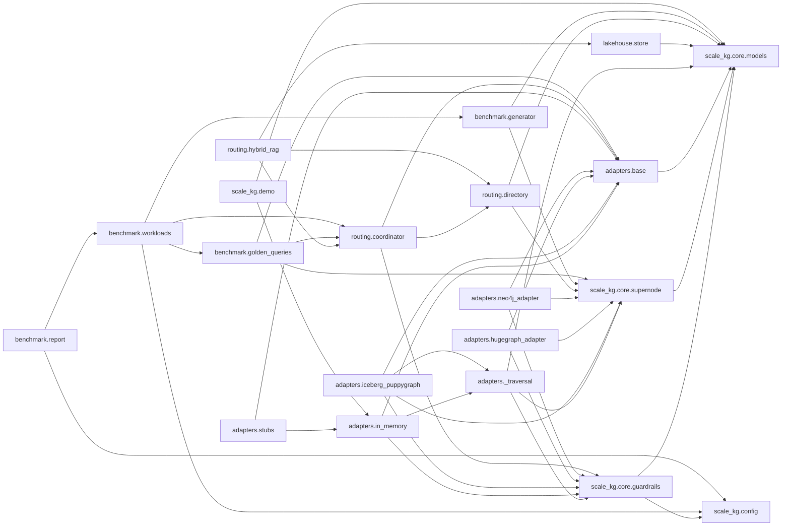
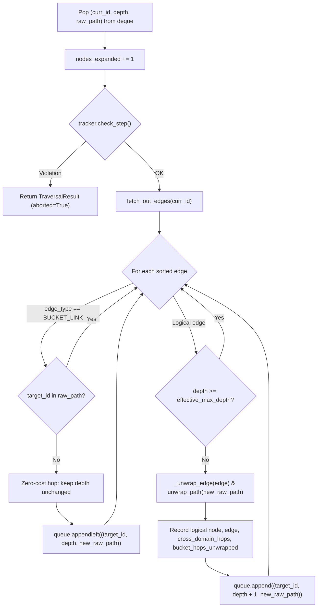
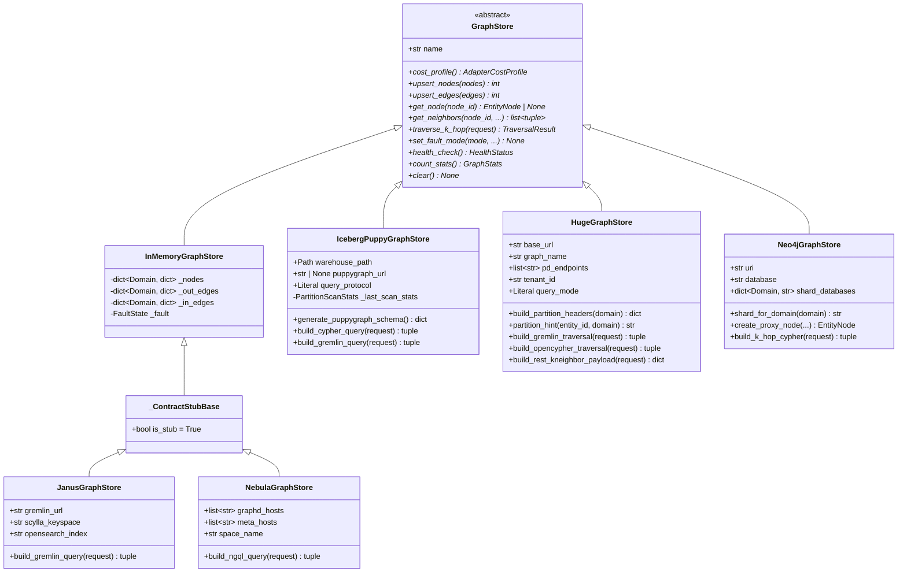
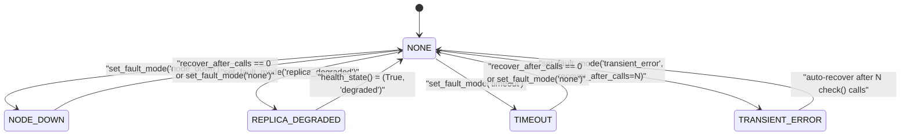
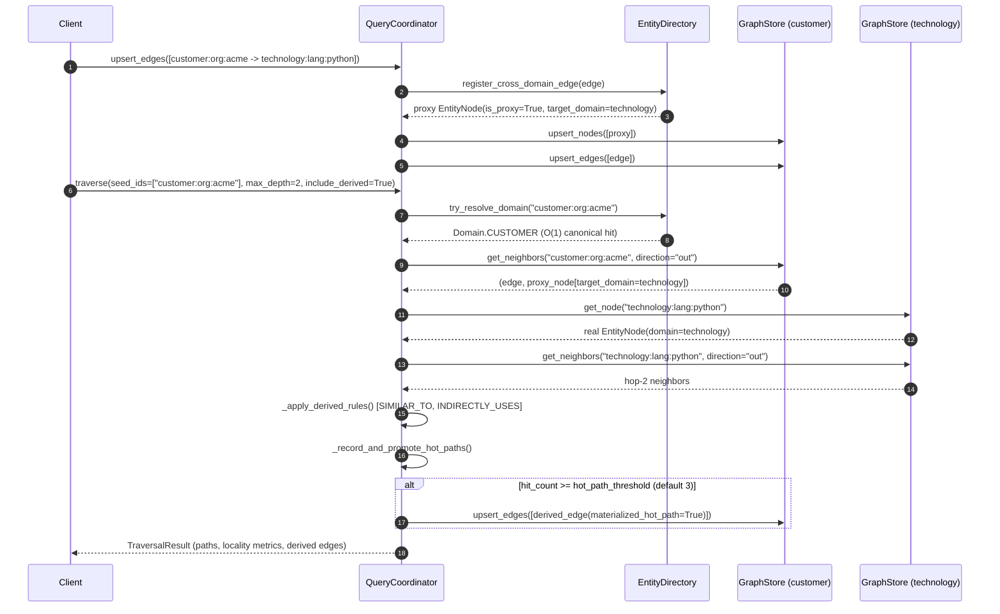
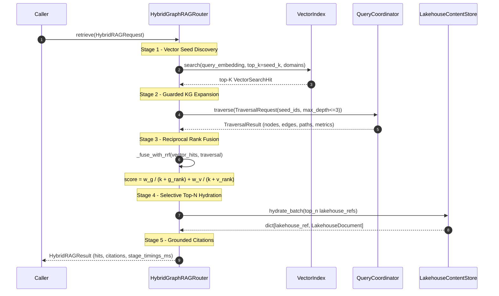
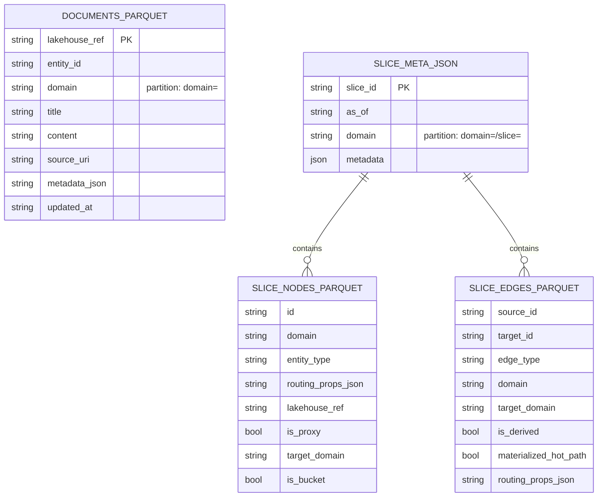
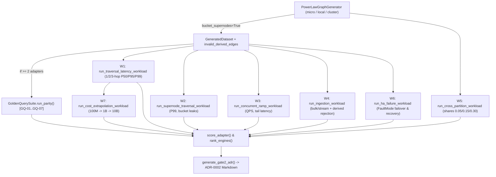

# Low-Level Design (LLD): Agent Nexus KG (`scale-kg`)

This document specifies the module-level contracts, data schemas, state machines, traversal algorithms, and execution sequences implemented in `src/scale_kg/`.

---

## 1. Package & Module Dependency Graph

---

## 2. Core Domain Models, Configuration & Guardrails

### 2.1 Class Diagram (`scale_kg.core` & `scale_kg.config`)

```mermaid
classDiagram
    class Domain {
        <<enumeration>>
        CUSTOMER = "customer"
        KNOWLEDGE = "knowledge"
        TECHNOLOGY = "technology"
        PRODUCT = "product"
    }

    class EntityNode {
        +str id
        +Domain domain
        +str entity_type
        +dict~str, RoutingPropValue~ routing_props
        +str | None lakehouse_ref
        +bool is_proxy = False
        +Domain | None target_domain
        +bool is_bucket = False
    }

    class RelationshipEdge {
        +str source_id
        +str target_id
        +str edge_type
        +Domain domain
        +Domain | None target_domain
        +bool is_derived = False
        +bool materialized_hot_path = False
        +dict~str, RoutingPropValue~ routing_props
    }

    class TraversalRequest {
        +list~str~ seed_ids
        +int max_depth = 2
        +list~str~ | None edge_types
        +list~Domain~ | None domains
        +int max_results = 5000
        +float max_execution_seconds = 2.0
        +int max_expanded_nodes = 50000
        +bool include_derived = False
    }

    class TraversalMetrics {
        +int depth_reached
        +int nodes_expanded
        +int results_returned
        +float execution_time_ms
        +int cross_domain_hops
        +float single_domain_locality_ratio
        +int bucket_hops_unwrapped
        +bool aborted
        +GuardrailViolation | None violation
    }

    class TraversalResult {
        +list~str~ seed_ids
        +list~EntityNode~ nodes
        +list~RelationshipEdge~ edges
        +list~list~str~~ paths
        +TraversalMetrics metrics
    }

    class GuardrailConfig {
        +int max_depth = 3
        +int max_results = 5000
        +float max_execution_seconds = 2.0
        +int max_expanded_nodes = 50000
    }

    class LatencyBudgetConfig {
        +float hop_1_p95_ms = 25.0
        +float hop_2_p95_ms = 100.0
        +float hop_3_p95_ms = 300.0
        +float hard_timeout_ms = 2000.0
        +budget_for_depth(depth: int) float
        +is_within_budget(depth: int, observed_p95_ms: float) bool
    }

    class ScaleKGConfig {
        +GuardrailConfig guardrails
        +LatencyBudgetConfig latency_budgets
        +int supernode_degree_threshold = 1000
        +int num_buckets = 16
    }

    class GuardrailEnforcer {
        +GuardrailConfig config
        +validate_node_write(node: EntityNode) None
        +validate_edge_write(edge: RelationshipEdge) None
        +validate_request(req: TraversalRequest) None
        +create_runtime_tracker(req: TraversalRequest) RuntimeGuardrailTracker
    }

    class RuntimeGuardrailTracker {
        +elapsed_seconds float
        +check_step(depth, expanded_nodes, results_count) GuardrailViolation | None
        +enforce_step(depth, expanded_nodes, results_count) None
        +build_aborted_result(...) TraversalResult
    }

    ScaleKGConfig *-- GuardrailConfig
    ScaleKGConfig *-- LatencyBudgetConfig
    GuardrailEnforcer --> GuardrailConfig
    GuardrailEnforcer ..> RuntimeGuardrailTracker : creates
    TraversalResult *-- TraversalMetrics
    TraversalResult *-- EntityNode
    TraversalResult *-- RelationshipEdge
```

### 2.2 Guardrail Enforcement Matrix

| Phase | Trigger Method | Condition Checked | Violation Code (`GuardrailViolationCode`) | Behavior |
| :--- | :--- | :--- | :--- | :--- |
| `write` | `validate_node_write` / `validate_edge_write` | `routing_props` key in `{"content", "raw_text", "embedding", "history_blob"}` | `LEAN_GRAPH_FORBIDDEN_PAYLOAD` | Raises `GuardrailViolationError` |
| `write` | `validate_node_write` | `entity_type` in `CONTENT_BEARING_ENTITY_TYPES` or `routing_props["has_content"]` truthy without non-empty `lakehouse_ref` | `LEAN_GRAPH_MISSING_LAKEHOUSE_REF` | Raises `GuardrailViolationError` |
| `write` | `validate_edge_write` | `is_derived=True` or `edge_type` in `{"SIMILAR_TO", "INDIRECTLY_USES"}` with `materialized_hot_path=False` | `UNMATERIALIZED_DERIVED_EDGE` | Raises `GuardrailViolationError` |
| `preflight` | `validate_request` | `seed_ids` is empty | `EMPTY_SEED_IDS` | Raises `GuardrailViolationError` |
| `preflight` | `validate_request` | `max_depth < 1` | `INVALID_DEPTH` | Raises `GuardrailViolationError` |
| `preflight` / `runtime` | `validate_request` / `check_step` | `depth > max_depth` (`<= 3`) | `MAX_DEPTH_EXCEEDED` | Raises preflight; returns partial `aborted=True` runtime |
| `preflight` / `runtime` | `validate_request` / `check_step` | `results_count > max_results` (`<= 5000`) | `MAX_RESULTS_EXCEEDED` | Raises preflight; returns partial `aborted=True` runtime |
| `preflight` / `runtime` | `validate_request` / `check_step` | `elapsed > max_execution_seconds` (`<= 2.0s`) | `MAX_EXECUTION_TIME_EXCEEDED` | Raises preflight; returns partial `aborted=True` runtime |
| `preflight` / `runtime` | `validate_request` / `check_step` | `expanded_nodes > max_expanded_nodes` (`<= 50000`) | `MAX_EXPANDED_NODES_EXCEEDED` | Raises preflight; returns partial `aborted=True` runtime |

---

## 3. Supernode Bucketing & 0-1 BFS Unwrapping (`scale_kg.core.supernode` & `adapters._traversal`)

### 3.1 Deterministic Bucket Allocation & Dataset Transform

1. **Bucket Hash:** `compute_bucket_id(node_id, num_buckets=16)` computes `zlib.crc32(node_id.encode("utf-8")) % num_buckets`.
2. **Hub Detection (`SupernodeRegistry`):** A vertex is classified as a supernode if:
   - Its `id` is in `seeded_ids` (`{"technology:lang:python", "customer:region:india"}`), OR
   - Its `entity_type.lower()` is in `seeded_types` (`{"language", "country"}`), OR
   - Its `id` is in `promoted_ids`, OR
   - Its degree `>= degree_threshold` (default `1000` in `SupernodeRegistry` / `100` in `SupernodeBucketer`).
3. **Bucket Materialization (`_build_buckets_for_hub`):** Creates 16 `EntityNode` instances (`<hub_id>::bucket::0..15`, `is_bucket=True`, `entity_type="<HubType>Bucket"`) and bidirectional `BUCKET_LINK` edges between the hub and each bucket vertex.
4. **Edge Rewriting (`_rewrite_edge`):**
   - If `source_id` is a supernode, `source_id` becomes `<source_id>::bucket::<crc32(target_id) % 16>`.
   - If `target_id` is a supernode, `target_id` becomes `<target_id>::bucket::<crc32(source_id) % 16>`.
   - Runtime degree overflow uses `SupernodeBucketer.promote_node(hub, existing_edges)` returning `(bucket_nodes, rewritten_edges, removed_edges)`.

### 3.2 0-1 BFS Traversal & Bucket Collapse Flow

---

## 4. Pluggable `GraphStore` Abstraction & Adapters (`scale_kg.adapters`)

### 4.1 Adapter Class Hierarchy

### 4.2 Fault Injection State Machine (`FaultState`)

- `NODE_DOWN` and `TRANSIENT_ERROR` raise `GraphStoreUnavailableError` when `applies_to(domain)` is true.
- `TIMEOUT` raises `TimeoutError`.
- `REPLICA_DEGRADED` allows operations to proceed while reporting `status="degraded"` in `health_check()`.

### 4.3 Adapter Internal Storage & Execution Mechanics

1. **`IcebergPuppyGraphStore` (Zero-ETL Parquet + PuppyGraph):**
   - **Disk Layout:**
     - `nodes/domain=<domain>/bucket_16=<0..15>/part-00000.parquet` (`NODE_ARROW_SCHEMA`: 9 columns including `bucket_16: int32`)
     - `edges/domain=<domain>/bucket_16=<0..15>/part-00000.parquet` (`EDGE_ARROW_SCHEMA`: 10 columns including `source_bucket_16`, `target_bucket_16`)
     - `metadata/v1.metadata.json` (Iceberg v2 format metadata with `domain` identity + `bucket[16]` partition spec)
     - `puppygraph_schema.json` (Hadoop Iceberg catalog + `Entity` vertex / `RELATIONSHIP` edge mappings)
   - **Local Mode (`puppygraph_url=None`):** `_read_node_local` and `_read_out_edges_local` filter candidate Parquet files by `bucket_16=compute_bucket_id(node_id, 16)` and apply PyArrow row-group pushdown filters (`filters=[("id", "=", node_id)]` / `[("source_id", "=", node_id)]`), recording `PartitionScanStats.pruning_ratio`.
   - **Remote Mode (`puppygraph_url` configured):** Posts bounded Cypher (`/cypher`) or Gremlin (`/gremlin`) queries over `httpx` and unwraps returned `::bucket::k` paths.

2. **`HugeGraphStore` (PD + HStore REST / Gremlin / OpenCypher):**
   - Attaches `X-HugeGraph-Tenant`, `X-HugeGraph-Partition-Domain`, and `X-HugeGraph-PD-Endpoints` headers on every HTTP call.
   - Computes `partition_hint = "<domain>:<tenant>:<crc32_bucket_16>"` onto vertex/edge properties.
   - Supports `query_mode` in `{"gremlin", "opencypher", "rest"}` (`POST /graphs/{graph}/gremlin`, `/cypher`, or `/traversers/kneighbor`).

3. **`Neo4jGraphStore` (Composite Shards + Ghost/Proxy Nodes):**
   - Maps each `Domain` to a Neo4j database (`kg_customer`, `kg_knowledge`, `kg_technology`, `kg_product`).
   - On `upsert_edges()`, any cross-domain edge (`edge.target_domain != edge.domain`) triggers `create_proxy_node()` in the owning source shard (`is_proxy=True`, `target_domain`).
   - During `traverse_k_hop()`, encountering a proxy vertex pushes `(node.id, node.target_domain, next_used, full_lp)` onto `pending_shards` to resume bounded Cypher execution on the remote shard.

---

## 5. Semantic Domain Federation & Hot-Path Promotion (`scale_kg.routing`)

### 5.1 Split-Shard Write, Cross-Shard Traversal & Derived Edge Promotion Sequence

### 5.2 Derived Edge Rules (`DEFAULT_DERIVED_EDGE_RULES`)

| Rule Name | Derived Type | Pattern | Matching Logic |
| :--- | :--- | :--- | :--- |
| `similar_to_shared_neighbor` | `SIMILAR_TO` | `shared_neighbor` | For each collected core edge `u -> w`, queries incoming neighbors `v -> w` (`v != u`) across shards; emits `u -[SIMILAR_TO]-> v` when `shared_count >= min_shared_neighbors` (`1`). |
| `indirectly_uses_two_hop` | `INDIRECTLY_USES` | `two_hop_composition` | Joins core edge `e1` (`USES`, `DEPENDS_ON`) with `e2` (`DEPENDS_ON`, `USES`, `POWERS`, `REQUIRES`) where `e1.target_id == e2.source_id` (`effective_max_depth >= 2`). |

---

## 6. Hybrid Vector + KG + Lakehouse Pipeline (`scale_kg.routing.hybrid_rag` & `scale_kg.lakehouse.store`)

### 6.1 Five-Stage Seed-Then-Expand Execution Sequence

### 6.2 Lakehouse Parquet Data Model (`LakehouseContentStore`)

- `LakehouseContentStore` maintains an in-memory `_ref_domain_index` rebuilt on initialization from `documents/domain=<d>/documents.parquet` (`columns=["lakehouse_ref"]`) so `hydrate_batch()` reads only the Parquet domain partitions needed for the requested `top_n` references.

---

## 7. Benchmark Suite, Golden Parity & Gate 2 ADR (`scale_kg.benchmark`)

### 7.1 Benchmark Orchestration & Scoring Flow

### 7.2 Scale Presets (`SCALE_PRESETS`)

| Preset | Synthetic Nodes | Avg Degree | Power-Law Alpha | Supernode Fan-Out | Reference Scale Target | Concurrency Levels | Latency Samples / Depth |
| :--- | :---: | :---: | :---: | :---: | :---: | :---: | :---: |
| `micro` | 80 | 3.5 | 2.2 | 24 | 100M (`100_000_000`) | `[2, 4, 8]` | 6 |
| `local` | 1,000 | 6.0 | 2.2 | 120 | 1B (`1_000_000_000`) | `[4, 16, 32]` | 30 |
| `cluster` | 5,000 | 8.0 | 2.2 | 400 | 10B (`10_000_000_000`) | `[8, 32, 64]` | 60 |

### 7.3 Gate 2 Weighted Scoring Matrix (`score_adapter`)

- **Performance (35%):** Depth-averaged `100 - (observed_p95 / budget_p95) * 45` across hops 1–3, plus `+10` if `supernode.within_guardrails` (`-25` otherwise), plus `min(10, peak_qps / 50)`.
- **Scalability & Resilience (25%):** Base `60`, `+15` if `supports_cross_shard_edges`, `+15` if `ha_failure.recovered_cleanly` (`-30` otherwise), `+10` if `degradation_1b_to_10b_ratio <= 1.25` (`-15` if `> 1.8`), `-10` if `cross_partition.worst_latency_ratio > 3.0`.
- **Cost per Billion Edges (15%):** `100` if cost `<= 0`, else `clamp(100 - cost_usd / 40, 0, 100)`.
- **Operability (15%):** Complexity base (`low=90`, `medium=72`, `high=45`) plus `+8` if `supports_zero_etl`.
- **GraphRAG Fit (10%):** Base `55`, `+20` if `golden_parity_passed`, `+10` if `write_discipline_passed`, `+10` if `cypher`/`opencypher`/`gremlin` supported, `+5` if `supports_zero_etl`.
- **Production Eligibility:** Disqualifies `tier == "reference"`, `is_stub == True`, latency gate misses, failed HA recovery, or failed write-discipline checks.
