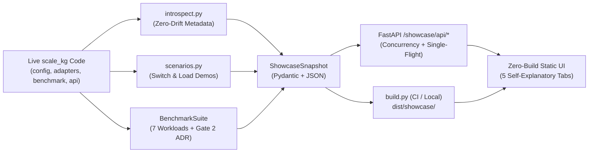

# Scale-KG Interactive Showcase & Auto-Updating Benchmark Dashboard — Design Specification

**Date:** 2026-11-24  
**Product:** Agent Nexus KG (`scale-kg`)  
**Branch:** `feature/showcase-dashboard`  
**Status:** Design Approved (Pending Written Spec Review)

---

## 1. Goal & Scope

Build a self-explanatory, auto-updating showcase dashboard and live interactive lab for `scale-kg` that demonstrates—without requiring a live 100M–10B edge cluster—**how `scale-kg` handles increasing scale and load** and **how it switches seamlessly across engines and internal runtime modes**.

### Locked Decisions
1. **Delivery Mode (Hybrid):**
   - **Live mode:** Mounted directly inside `scale_kg.api.app:create_app()` at `/showcase` and `/showcase/api/*` (opt-out via `enable_showcase: bool = True`).
   - **Static mode:** Same zero-build frontend bundle exported to `dist/showcase/` alongside `snapshot.json` and rolling `history.json`, automatically published to GitHub Pages on pushes to `main` and attached as a diffed preview on PRs.
2. **Core Narrative (Both Engine Switching & Load/Mechanism Switching):**
   - **How it handles load:** Progressive local scale ladder (`micro` → `local` → `cluster` presets), supernode degree ramp crossing `supernode_degree_threshold`, 3-hit derived-edge hot-path promotion, cross-domain Hop-0 + Ghost/Proxy federation, live Lean-Graph and runtime guardrail probes, 5-stage Hybrid GraphRAG RRF + selective Parquet hydration, and empirically calibrated 100M → 1B → 10B projections.
   - **How it switches engines:** Side-by-side `GraphStore` adapter switchboard (`InMemoryGraphStore`, `IcebergPuppyGraphStore` local PyArrow, auto-detected Docker `Neo4jGraphStore`/`HugeGraphStore`/remote PuppyGraph, and clearly badged Tier-2 contract stubs `JanusGraphStore`/`NebulaGraphStore`) showing 100% Golden Query parity (`GQ-01`..`GQ-07`), 7-workload benchmarks, and live Gate 2 weighted ADR scoring across 100M / 1B / 10B scale targets.
3. **Frontend Stack (Zero-Build):**
   - Pure vanilla HTML5, CSS3, and native ES modules with inline SVG charts (`src/scale_kg/showcase/static/`).
   - Zero Node.js/npm toolchain, zero third-party runtime CDN dependencies, zero drift between live FastAPI and static GitHub Pages builds.
4. **Concurrency Target (Up to 50 Concurrent Users):**
   - Architected for 50 concurrent dashboard users on a single Uvicorn async worker via immutable pre-warmed snapshot bytes, pre-seeded read-only multi-adapter playground, ephemeral micro-coordinators for mutation demos, and a `SingleFlightJobRunner` with parameter coalescing, bounded worker semaphore, TTL cache, and `429 Retry-After` backpressure.
5. **Auto-Update on Implementation Changes:**
   - Runtime Python introspection reads `ScaleKGConfig`, `Domain`, registered `GraphStore` adapters + `AdapterCostProfile`, `GoldenQuerySuite`, `SCALE_PRESETS`, and FastAPI routes directly from live code—no hardcoded UI thresholds or engine tables.
   - GitHub Actions workflow (`.github/workflows/showcase.yml`) rebuilds `dist/showcase/` on code/config changes, updates rolling commit trend `history.json` (up to 100 commits) on `main`, publishes GitHub Pages, and writes a benchmark delta table to `$GITHUB_STEP_SUMMARY` on PRs.

---

## 2. Package Architecture & Module Boundaries

All new Python code lives under a cohesive, isolated package `src/scale_kg/showcase/` that consumes existing `scale_kg` public contracts (`core`, `routing`, `adapters`, `lakehouse`, `benchmark`, `api`) without modifying core graph semantics.

```text
src/scale_kg/showcase/
├── __init__.py          # Public exports: ShowcaseSnapshot, ShowcaseService, create_showcase_router
├── introspect.py        # Dynamic code introspection (config, domains, adapters, golden queries, routes)
├── scenarios.py         # Deterministic self-explanatory mechanism demos & load-ramp traces
├── snapshot.py          # Pydantic schemas for ShowcaseSnapshot, CommitTrendEntry, and API payloads
├── concurrency.py       # Immutable snapshot cache, read-only playground, SingleFlightJobRunner
├── router.py            # FastAPI APIRouter (/showcase static UI + /showcase/api/* JSON endpoints)
├── build.py             # CLI & library exporter (`python -m scale_kg.showcase.build`)
└── static/
    ├── index.html       # Single-page shell (live & static mode compatible)
    ├── styles.css       # Responsive, accessible dark/light-aware dashboard stylesheet
    ├── app.js           # Mode detection (live vs static), state store, tab router
    ├── charts.js        # Zero-dependency SVG charts (latency bars, ramp lines, sparklines, waterfall)
    └── views.js         # 5 self-explanatory interactive view renderers
```

### Integration Boundaries
- **`scale_kg.api.app.create_app()`:** Gains three backward-compatible keyword parameters:
  - `enable_showcase: bool = True`
  - `showcase_snapshot_path: str | Path | None = None`
  - `showcase_require_auth: bool = False`
  When `enable_showcase=True`, mounts the showcase router at `/showcase` and `/showcase/api/*` without altering any `/v1/*` or gRPC contract.
- **`Makefile`:** Adds `showcase-build` and `showcase` targets alongside existing `setup`, `demo`, `dev`, and `check`.
- **`portfolio.yaml`:** Documents the `/showcase` UI and `/showcase/api/snapshot` endpoints as additive interface metadata.



---

## 3. Zero-Drift Code Introspection (`introspect.py`)

`introspect_system(config: ScaleKGConfig | None = None, app_routes: Sequence[str] | None = None) -> SystemIntrospection` reads live runtime definitions so documentation and UI controls cannot drift from implementation:

1. **Configuration & Thresholds:** Extracts every field, default value, and Pydantic bound from `GuardrailConfig` (`max_depth`, `max_results`, `max_execution_seconds`, `max_expanded_nodes`), `LatencyBudgetConfig` (`hop_1_p95_ms`, `hop_2_p95_ms`, `hop_3_p95_ms`, `hard_timeout_ms`), and `ScaleKGConfig` (`supernode_degree_threshold`, `num_buckets`), plus a deterministic SHA-256 `config_fingerprint`.
2. **Semantic Domains & Shards:** Enumerates all members of `Domain` (`customer`, `knowledge`, `technology`, `product`) and canonical ID parsing rules (`<domain>:<entity_type>:<slug>`).
3. **Adapter Catalog:** Discovers all concrete `GraphStore` adapters exported by `scale_kg.adapters` (`InMemoryGraphStore`, `IcebergPuppyGraphStore`, `HugeGraphStore`, `Neo4jGraphStore`, `JanusGraphStore`, `NebulaGraphStore`) and reads each adapter's live `cost_profile()` (`tier`, `is_stub`, `estimated_monthly_cost_per_billion_edges_usd`, `operational_complexity`, `supports_zero_etl`, `supports_cross_shard_edges`, `query_languages`).
4. **Live Environment Detection:** Performs bounded non-blocking health checks (`timeout=0.5s`) for optional remote/Docker adapters when env URLs are configured (`NEO4J_URI`, `HUGEGRAPH_URL`, `PUPPYGRAPH_URL`), tagging each adapter as `verified_local`, `live_remote`, `offline_remote`, or `contract_stub`.
5. **Scale Presets & Golden Queries:** Reads `SCALE_PRESETS` (`micro`, `local`, `cluster`) and `GoldenQuerySuite` definitions (`GQ-01`..`GQ-07`) directly from `scale_kg.benchmark`.
6. **Public Interface Surface:** Lists mounted `/v1/*` and gRPC routes plus package version, Python version, git SHA, and UTC build timestamp.

---

## 4. Self-Explanatory Scenarios & 5-Tab Dashboard UX

The UI loads identically in **Live Mode** (fetches `/showcase/api/snapshot`, enables live server-backed interactive triggers) and **Static Mode** (loads `./snapshot.json` and `./history.json`, replays deterministic snapshot traces and client-side scale/cost calculations cleanly with a `Static Snapshot` badge).

### Tab 1: System Map & Switch Rules
- Interactive 4-layer architecture diagram (`HybridGraphRAGRouter` → `QueryCoordinator / GuardrailEnforcer / SupernodeBucketer / EntityDirectory` → `GraphStore Adapters` → `LakehouseContentStore`).
- Live introspected threshold cards showing exact active limits and the trigger condition for each runtime switch:
  - Degree $\ge$ `supernode_degree_threshold` → 16-way `::bucket::0..15` split + 0-1 BFS unwrap.
  - Derived edge hit count $\ge$ `hot_path_threshold` (3) → `materialized_hot_path=True` promotion.
  - Cross-domain edge in split-shard topology → in-shard Ghost/Proxy vertex injection + Hop-0 prefix routing.
  - Payload or traversal budget breach → HTTP `422` `GuardrailViolation` or runtime `aborted=True` partial result.
- Clicking any layer highlights the corresponding Python module path, active config limits, and live/snapshot telemetry counters.

### Tab 2: Load & Volume Escalator ("How It Handles Scale")
Demonstrates behavior under rising volume and stress without requiring 10B live rows:
1. **Progressive Scale Ladder:** Empirical benchmark series across local presets (`micro`: 80 nodes / 100M ref → `local`: 1,000 nodes / 1B ref, plus optional CLI/CI `cluster`: 5,000 nodes / 10B ref via `--presets micro,local,cluster` or `workflow_dispatch`) showing 1/2/3-hop P95 latency against Gate 2 SLA lines (25ms / 100ms / 300ms) and QPS ramp.
2. **Supernode Degree Ramp (`run_supernode_ramp`):** Measures real traversal latency, expanded nodes, bucket hops unwrapped, and raw bucket leaks (`== 0`) as hub degree scales across `[8, 16, 32, 64, 128, 256, 512]` with a configurable demo threshold (e.g. `threshold=32`) showing the exact point where `SupernodeBucketer` flips from direct edges to 16-way `::bucket::0..15` partitions and keeps logical hop depth unchanged.
3. **Derived-Edge Hot-Path Stepper (`run_hot_path_demo`):** Interactive 3-step execution showing Hit #1 (on-the-fly rule inference, `materialized=False`), Hit #2 (on-the-fly), and Hit #3 (auto-promoted to `materialized_hot_path=True`, persisted core fast path) with per-step latency and promotion counters.
4. **Cross-Domain Federation Inspector (`run_federation_demo`):** Shows O(1) Hop-0 domain parsing (`customer:org:acme` → `customer` shard), Ghost/Proxy node creation on cross-shard edges, and `single_domain_locality_ratio` vs `cross_domain_hops` as cross-domain edge share increases from 10% → 40%.
5. **Interactive Guardrail Stress Triggers (`run_guardrail_probe`):** Four one-click probes executing real `GuardrailEnforcer` / `QueryCoordinator` calls and rendering the exact structured error/result:
   - `forbidden_payload`: attempts to write `routing_props={"content": "..."}` → `LEAN_GRAPH_FORBIDDEN_PAYLOAD` (`422`).
   - `missing_lakehouse_ref`: attempts to write `Document` without `lakehouse_ref` → `LEAN_GRAPH_MISSING_LAKEHOUSE_REF` (`422`).
   - `preflight_depth_cap`: requests `max_depth=4` → `MAX_DEPTH_EXCEEDED` (`422`).
   - `runtime_expansion_abort`: triggers tight `max_expanded_nodes` budget mid-BFS → partial `TraversalResult` with `metrics.aborted=True` and `MAX_EXPANDED_NODES_EXCEEDED`.

### Tab 3: Adapter Switchboard & Gate 2 ADR ("How It Switches")
1. **Engine Comparison Table & Switcher:** Toggle between available adapters (`in_memory`, `iceberg_puppygraph`, any live Docker adapter, and badged stubs `janusgraph`, `nebula`).
2. **Golden Query Parity Matrix (`GQ-01`..`GQ-07`):** Per-query pass/fail matrix proving 100% node, edge, and path parity and `0` leaked bucket vertices when swapping adapters behind `GraphStore`.
3. **7-Workload Benchmark Charts:**
   - 1/2/3-hop P50/P95/P99 latency grouped bars vs Gate 2 SLA thresholds.
   - Concurrent QPS ramp curve (`concurrency` vs `QPS` & `P95`).
   - Ingestion throughput (`bulk_edges_per_sec`, `stream_edges_per_sec`) + write-discipline rejection verification.
   - Cross-partition cost ratio + HA fault-injection recovery status.
4. **100M → 1B → 10B Scale & Cost Extrapolator + Live Gate 2 Scorecard:** Interactive target-scale selector (`100M`, `1B`, `10B`) showing projected monthly infrastructure cost, 1B→10B degradation ratio, weighted Gate 2 scores (Performance 35%, Scalability & Resilience 25%, Cost 15%, Operability 15%, GraphRAG Fit 10%), eligibility badges (disqualifying reference baselines and contract stubs), and rendered Gate 2 ADR rationale.

### Tab 4: Hybrid GraphRAG 5-Stage Trace
- Interactive trace of `HybridGraphRAGRouter.retrieve()` on a seeded multi-domain dataset with real Parquet `LakehouseContentStore` documents:
  1. Stage 1: Vector Seed Lookup (`InMemoryVectorIndex`)
  2. Stage 2: Guarded KG Expansion (`QueryCoordinator`)
  3. Stage 3: Reciprocal Rank Fusion (`rrf_k=60`)
  4. Stage 4: Selective Top-N Parquet Hydration (`LakehouseContentStore`)
  5. Stage 5: Grounded `SourceCitation` & Supporting Paths
- Displays per-stage `stage_timings_ms` waterfall and a concrete payload savings comparison (bytes hydrated for top-N hits vs storing all document payloads inside graph vertices).

### Tab 5: Commit Trend & Drift Monitor
- Reads `history.json` (in both Live and Static modes) and plots multi-commit SVG sparklines for:
  - 1/2/3-hop P95 latency across commits (`in_memory` and `iceberg_puppygraph`)
  - Peak QPS and Gate 2 weighted total score
  - Golden Query parity & guardrail pass streak
- Displays current build metadata: `git_sha`, `built_at`, `config_fingerprint`, active presets, and commit-over-commit delta badges.

---

## 5. 50-Concurrent-User Backend Design (`concurrency.py` & `router.py`)

To sustain **50 concurrent users** smoothly on a single FastAPI/Uvicorn async worker without event-loop blocking, state corruption, or OOM:

### Endpoint Surface (`/showcase` & `/showcase/api/*`)
| Method & Path | Purpose | Concurrency Strategy |
| :--- | :--- | :--- |
| `GET /showcase` | Dashboard HTML shell (`index.html`) | Static file response with `Cache-Control: public, max-age=300` |
| `GET /showcase/assets/{filename}` | Allowlisted static assets (`styles.css`, `app.js`, `charts.js`, `views.js`) | Static file response (no path traversal) with `Cache-Control: public, max-age=300` |
| `GET /showcase/api/snapshot` | Full canonical `ShowcaseSnapshot` | Pre-serialized UTF-8 bytes in RAM + `ETag` (`304 Not Modified` support) — O(1) read |
| `GET /showcase/api/history` | Rolling commit trend (`history.json`) | Cached in RAM (reloaded if file mtime changes) |
| `POST /showcase/api/simulate/adapter-switch` | Compare 1–2 adapters on a selected Golden Query (`GQ-01`..`GQ-07`) | Pre-seeded read-only adapters + `Semaphore(50)` + `2.0s` timeout |
| `POST /showcase/api/simulate/guardrail` | Execute one of the 4 allowlisted guardrail probes | Ephemeral 5-node `QueryCoordinator` per request (<2ms, zero shared state) + `Semaphore(50)` |
| `POST /showcase/api/simulate/hot-path` | Run 1..4 traversal hits demonstrating derived-edge promotion | Ephemeral micro-coordinator per request (<3ms) + `Semaphore(50)` |
| `POST /showcase/api/simulate/hybrid` | Run 5-stage Hybrid GraphRAG trace on pre-seeded dataset | Pre-seeded read-only `HybridGraphRAGRouter` + `Semaphore(50)` |
| `POST /showcase/api/ramp/run` | Trigger live scale benchmark (`preset` in `micro`, `local`; allowlisted adapters) | `SingleFlightJobRunner`: deduplicates identical requests into 1 `asyncio.to_thread()` run |

### Initialization & Lifecycle
- `ShowcaseService` loads a pre-built snapshot file if `showcase_snapshot_path` exists; otherwise lazily initializes the default `micro` snapshot and read-only multi-adapter playground under a single-flight `asyncio.Lock` on first async request (also callable eagerly at FastAPI startup). This guarantees compatibility with both Uvicorn servers and ASGI test transports (`httpx.AsyncClient(transport=ASGITransport(...))`) that skip lifespan events.

### `SingleFlightJobRunner` Invariants
1. **Canonical Key Coalescing:** Requests with identical `(preset, tuple(sorted(adapters)), seed)` share a single in-flight `asyncio.Future`. If 50 concurrent users click "Run `local` Ramp" simultaneously, the benchmark executes **once**, and all 50 receive the exact result.
2. **Bounded Result Cache:** LRU + TTL cache (`max_entries=32`, `ttl_seconds=300`) serves repeat requests immediately without recomputation.
3. **Bounded Parallelism & Backpressure:** `asyncio.Semaphore(2)` caps concurrent distinct heavy jobs; `max_pending=8` rejects excess distinct jobs immediately with HTTP `429 Too Many Requests`, structured JSON error body, and `Retry-After: 5` header.
4. **Event-Loop Protection:** CPU/IO-heavy `PowerLawGraphGenerator`, PyArrow Parquet writes/scans, and `BenchmarkSuite` calls execute off the main loop via `asyncio.to_thread()` (using isolated event loops for synchronous bridge helpers or async-safe thread offload) so concurrent read/health requests stay sub-50ms.
5. **Security & Validation:**
   - All parameters strictly validated via Pydantic `Literal` / bounded integers (`seed` bounded, `preset` allowlisted to `micro`/`local` on live public API; `cluster` reserved for CLI/CI builds to prevent DoS).
   - Never exposes environment variables, credentials, API keys, or absolute host filesystem paths in snapshots or API errors.
   - Optional auth enforcement (`showcase_require_auth=True`) reuses `verify_api_key_token` when deployed behind private API keys.

---

## 6. Auto-Update & CI Pipeline (`build.py` & `.github/workflows/showcase.yml`)

### Local & CI Static Builder (`scale_kg.showcase.build`)
```bash
uv run python -m scale_kg.showcase.build \
  --presets micro,local \
  --out dist/showcase \
  --history-in /tmp/prev-history.json
```
Produces a completely self-contained static directory:
```text
dist/showcase/
├── index.html          # Configured with data-mode="static"
├── styles.css
├── app.js
├── charts.js
├── views.js
├── snapshot.json       # Full ShowcaseSnapshot (introspection + scenarios + benchmarks + Gate 2 ADR)
└── history.json        # Rolling commit trend (max 100 entries, deduplicated by git_sha)
```

### GitHub Actions Workflow (`.github/workflows/showcase.yml`)
- **Triggers:**
  - `push` to `main` (paths: `src/scale_kg/**`, `pyproject.toml`, `Makefile`, `.github/workflows/showcase.yml`)
  - `pull_request` (same paths)
  - `workflow_dispatch` (manual refresh, optional `include_cluster` input)
- **Build Job:**
  1. Checks out repo and installs locked deps (`make setup`).
  2. Attempts to fetch prior `history.json` from the live Pages URL (graceful empty-list fallback on first deploy or unreachable endpoint).
  3. Runs `python -m scale_kg.showcase.build --presets micro,local --out dist/showcase --git-sha "$GITHUB_SHA" --git-ref "$GITHUB_REF_NAME"`.
  4. On `pull_request`: runs a lightweight diff helper comparing current `snapshot.json` against the latest entry in `history.json` (if present), writing a concise Markdown delta table (1/2/3-hop P95, Peak QPS, Golden Parity, Gate 2 Winner, Config Fingerprint change) to `$GITHUB_STEP_SUMMARY` and uploading `dist/showcase` as a workflow artifact.
- **Deploy Job (`main` only):**
  - Uses `actions/upload-pages-artifact` + `actions/deploy-pages` with minimal permissions (`pages: write`, `id-token: write`, `contents: read`).

---

## 7. Error Handling & Graceful Degradation

- **Offline Remote Adapters:** `HugeGraphStore`, `Neo4jGraphStore`, and remote PuppyGraph are never assumed reachable; a 500ms probe failure cleanly marks them `offline_remote` while `InMemoryGraphStore` and `IcebergPuppyGraphStore` (local PyArrow) always succeed offline.
- **Invalid/Missing Snapshot File:** If `showcase_snapshot_path` is omitted or missing at FastAPI startup, `ShowcaseService` computes a fast `micro` snapshot in memory on startup (<1s) so `/showcase` works out of the box with `make dev`.
- **Static Mode Parity:** If `/showcase/api/snapshot` is unavailable or `data-mode="static"` is set, `app.js` loads `./snapshot.json` and `./history.json` locally and routes interactive controls (guardrail probes, hot-path stepper, adapter switch, scale slider) to pre-computed deterministic scenario outputs with zero broken buttons or unhandled console errors.
- **Overload Backpressure:** Heavy ramp saturation returns deterministic `429` JSON + `Retry-After` rather than hanging requests or raising unhandled `500` errors.

---

## 8. Verification & Acceptance Criteria

1. **Zero-Drift Introspection Tests (`tests/test_showcase_introspect.py`):**
   - Verifies every `GuardrailConfig` field, `LatencyBudgetConfig` field, `Domain` enum member, `SCALE_PRESETS` key, `GoldenQuerySuite` ID, and concrete `GraphStore` adapter in `scale_kg.adapters` is dynamically captured.
   - Verifies changing a `ScaleKGConfig` value immediately changes `config_fingerprint` and reported threshold metadata.
2. **Scenario & Switch-Behavior Tests (`tests/test_showcase_scenarios.py`):**
   - Supernode degree ramp crosses threshold, triggers 16-way bucketing, maintains `raw_bucket_leaks == 0`, and records bucket hops unwrapped.
   - Hot-path stepper transitions from `materialized=False` on hits 1–2 to `materialized=True` on hit 3.
   - Cross-domain federation scenario reports positive `cross_domain_hops`, ghost proxies created, and accurate `single_domain_locality_ratio`.
   - All 4 guardrail probes produce their exact expected `GuardrailViolationCode` (`LEAN_GRAPH_FORBIDDEN_PAYLOAD`, `LEAN_GRAPH_MISSING_LAKEHOUSE_REF`, `MAX_DEPTH_EXCEEDED`, `MAX_EXPANDED_NODES_EXCEEDED` with `aborted=True`).
   - Hybrid GraphRAG trace verifies all 5 `stage_timings_ms` keys, citations, and selective hydration byte reduction vs naive full storage.
3. **50-Concurrent-User Load & Coalescing Tests (`tests/test_showcase_concurrency.py`):**
   - Launches 50 concurrent async clients (`asyncio.gather`) against the FastAPI ASGI app hitting `/showcase/api/snapshot`, `/simulate/adapter-switch`, `/simulate/guardrail`, `/simulate/hot-path`, and `/ramp/run`.
   - Asserts 50/50 successful HTTP `200` responses, zero uncaught exceptions, `ETag` / `304` behavior, read P95 < 50ms, and single-flight execution count `== 1` for 50 simultaneous identical `/ramp/run` calls.
   - Asserts `429` + `Retry-After` backpressure when distinct heavy jobs exceed `max_pending`.
4. **Static Export & CI Diff Tests (`tests/test_showcase_build.py`):**
   - Runs `build_showcase_site()` into `tmp_path`, asserts all required files exist, `snapshot.json` validates against `ShowcaseSnapshot`, `history.json` deduplicates and caps at 100 entries, and HTML/JS/CSS contain zero external CDN URLs or leaked host paths.
5. **Repository Quality Gates:**
   - `make check` (`uv run ruff format --check .`, `uv run ruff check .`, `uv run mypy src`, `uv run pytest`, `uv build`) passes with zero warnings/errors.
   - Existing `/v1/*` and gRPC tests remain 100% passing with zero regressions.
